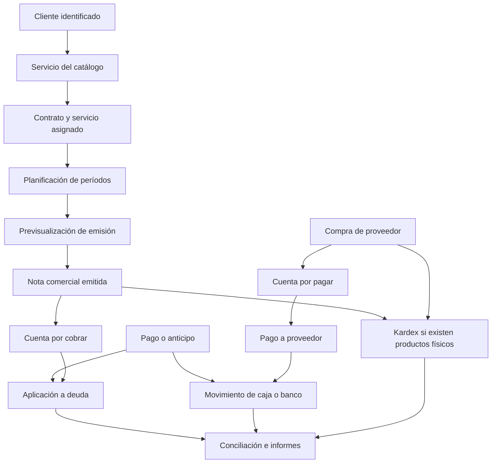

# Informe consolidado y plan integral de correcciones — Control INNTEL

**Fecha:** 27 de octubre de 2026 — Ecuador.  
**Base de código contrastada:** `365ce426d8124fe9b4f9395364ce835584881a60`, con observaciones de cambios locales al cierre indicadas en la sección 2.  
**Objetivo:** convertir las dos auditorías en un plan de correcciones ejecutable, con reglas de negocio, dependencias, recuperación de datos y criterios de aceptación.  
**Estado:** especificación de remediación; este documento no acredita correcciones implementadas.

## 1. Dictamen y alcance

El flujo comercial requiere corregir primero identidad, emisión, relaciones y movimientos de dinero. Hoy una operación puede originar un documento repetido, dos cuentas por cobrar, servicios adicionales o una eliminación que afecta a otro cliente. Corregir únicamente las tablas, los botones o el formato de los informes no resolvería esas causas.

La prioridad es recuperar estas garantías:

1. Cada cliente y registro conserva una identidad única que nunca se reutiliza.
2. Cada servicio se cobra una sola vez por período y concepto.
3. Cada documento comercial tiene un número único dentro de su serie.
4. Cada deuda, pago, aplicación, anticipo y movimiento bancario conserva su origen.
5. Una corrección afecta exclusivamente a los registros que le corresponden.
6. Cartera, saldos del cliente, bancos, inventario e informes concilian después de cada operación.
7. Un error de persistencia no se presenta al usuario como una operación exitosa.

**Alcance:** clientes, catálogo, contratos, asignación de servicios, ventas internas, recurrencia, cobranzas, anticipos, CxC, compras, CxP, bancos, movimientos, inventario, kardex, informes, documentos comerciales impresos, navegación, permisos y UX/UI del proceso.

**Exclusión mantenida:** Facturación SRI, firma, autorización, transmisión, contingencia y validación normativa tributaria. Revisar una nota comercial, sus importes y sus relaciones no implica haber auditado ese módulo.

## 2. Fuentes, evidencia y límites de esta consolidación

### Fuentes utilizadas

- **Auditoría A:** [informe QA del 26 de octubre](INFORME_QA_PROCESO_COMERCIAL_2026-10-26.md), con 28 hallazgos y pruebas en copia aislada.
- **Auditoría B:** [segunda opinión del 27 de octubre](INFORME-TOTAL-QA-INNTEL-CORP-2026-10-27.md), también aportada como texto adjunto, con 30 hallazgos.
- Capturas aportadas en [evidencias de la segunda opinión](qa-2026-10-27/evidencias/).
- Snapshots antes/después disponibles localmente en la carpeta temporal de QA indicada por la segunda opinión. Se leyeron únicamente archivos de datos y scripts de prueba necesarios para contrastar sus resultados; no se utilizó la sesión guardada para conectarse a servicios.
- Código actual de los componentes, del estado global, de la API, de sus validaciones y de las reglas locales de Firestore.

Los 28 y 30 hallazgos **no equivalen a 58 fallos independientes**: hay coincidencias, causas compartidas y observaciones de diseño. Se organizan aquí en **27 paquetes de corrección**, identificados como R01–R27, con trazabilidad a ambos informes.

### Resultados adicionales contrastados

| Evidencia aportada | Antes | Después | Conclusión respaldada |
|---|---:|---:|---|
| Lote de recurrencia | 3 documentos y 3 cargos | 6 documentos y 5 cargos | Los tres documentos nuevos comparten el número terminado en 003; los importes nuevos son $287,50, $3.128,00 y $115,00, de tres clientes distintos. |
| Eliminación de servicio | 15 servicios, 1 cargo y 4 documentos | 14 servicios y 0 cargos; siguen 4 documentos | Desaparece una deuda sin desaparecer el documento comercial de origen. |
| Eliminación de cliente | 6 clientes, 14 servicios y 4 documentos | 5 clientes, 12 servicios y 4 documentos | La baja física no preserva una relación consistente entre cliente y documentos. |

La primera fila demuestra duplicidad de numeración en los archivos aportados. No demuestra por sí sola qué reglas estaban desplegadas en Firebase ni que todos los cambios persistieran en la nube. La revisión de código confirma que existen las rutas que permiten esas inconsistencias.

La segunda fila usa los recuentos **globales** de los snapshots. Los recuentos por cliente citados por la segunda opinión pueden ser distintos porque tienen otro alcance.

Esta consolidación no volvió a ejecutar pruebas destructivas ni modificó registros de producción. Tampoco revalidó impresión física, correo real, concurrencia entre equipos o recuperación de una copia real de Firebase.

### Cambios locales observados al cierre

Durante la preparación del informe aparecieron modificaciones locales de código que esta consolidación no realizó. Se revisaron para no presentar el diagnóstico de la versión base como si esos avances no existieran. No se consideran soluciones verificadas ni desplegadas:

| Archivo | Cambio observado | Trabajo que sigue abierto |
|---|---|---|
| `ClientContractTab.tsx` | Sustituye el selector técnico por una etiqueta de categoría de catálogo. | En alta muestra `categoryName`, mientras en edición muestra `serviceCategory`; validar una fuente canónica y separar frecuencia/tipo técnico. Ocultar el selector no resuelve por sí solo el calendario ni la inferencia por nombre. |
| `ProductModal.tsx` | Restringe categorías de servicios si existe alguna de ese tipo. | Resolver el caso sin categorías de servicio, el filtro para productos y una categoría previamente seleccionada incompatible. |
| `FinancialReportsTab.tsx` | Excluye movimientos `cobro_cliente` de una de las sumas para evitar duplicación. | Revalidar orígenes, cortes, cobros ya eliminados, anticipos, transferencias y gráficos con cifras fijas; aún requiere R20 completo. |
| `qa-commercial-audit.test.ts` | Agrega ejemplos con objetos locales, algunas funciones auxiliares y búsquedas de texto en archivos. | No demuestra que los comandos reales creen, cobren o anulen correctamente ni que persistan en Firebase. No sustituye la regresión de integración y navegador de R27. |

Los paquetes siguientes conservan el diagnóstico de la base y definen el cierre funcional completo; las cuatro observaciones anteriores deben incluirse en la siguiente revalidación.

## 3. Precisiones necesarias antes de convertir los informes en tareas

| Afirmación o recomendación previa | Evaluación consolidada |
|---|---|
| “El lote usa llamadas concurrentes y por eso repite números”. | El código usa un bucle con `await`. El problema también ocurre con llamadas secuenciales: el emisor conserva el estado de un render anterior. Se necesita reserva de correlativo en servidor; cambiar solamente el bucle no garantiza unicidad. |
| “El lote no bloquea el botón”. | El botón sí usa `disabled={emittingBatch ...}` y existe `finally`. Se mantiene el problema de espera sin progreso, confirmación persistente ni recuperación. No se afirma que no exista bloqueo. |
| “Al cancelar se revierte lo que ya se hizo”. | Cerrar el modal, cerrar el navegador o vencer una espera no revierte una operación confirmada en el servidor. El trabajo debe tener un estado consultable y reintentos seguros. |
| “Todo el lote debe ir en una única transacción”. | Cada documento y sus efectos inseparables deben ser atómicos. Un lote grande debe ser un trabajo durable compuesto por esas unidades, sin depender de una transacción ilimitada. |
| “Banco y deuda del cliente deben variar siempre el mismo importe”. | Son magnitudes distintas. Un pago reduce deuda y aumenta banco; una anulación puede revertir deuda pendiente, preservar un anticipo o requerir devolución. Deben conciliar por aplicaciones y eventos, no por igualdad artificial de dos saldos. |
| “Precio Total $50 y Valor Total $57,50 prueba un error aritmético”. | La captura muestra base $50 + IVA $7,50 = $57,50. El cálculo visible es coherente; la etiqueta de la columna debe indicar “Subtotal sin IVA”. No se debe agregar el impuesto dos veces al corregir la impresión. |
| “Una categoría vacía o sin botón de borrar es un bug”. | Una categoría puede existir sin registros y una CxC emitida puede necesitar anulación controlada. Se exige contexto y una operación segura; no se exige ocultar categorías ni agregar borrado físico por defecto. |
| “Todo precio cero debe rechazarse”. | Un cero accidental debe detectarse. Una gratuidad, bonificación o prueba comercial autorizada debe representarse explícitamente con motivo, alcance y aprobación. No sustituir un cero válido por un precio arbitrario. |
| “El nombre anterior del banco en un movimiento está corrupto”. | Un nombre histórico puede ser una instantánea válida. El vínculo estable es `bankAccountId`; deben distinguirse nombre actual e histórico y detectarse referencias sin cuenta. |
| “Saldo inicial sin movimiento siempre es incorrecto”. | Puede representarse como saldo de apertura separado más movimientos posteriores, o como asiento de apertura. Debe elegirse un modelo y evitar contarlo dos veces. |
| “La venta siempre inicia en Consumidor Final”. | El código actual inicializa `isConsumidorFinal=false` y al elegir un cliente lo pone en falso. El síntoma informado puede depender de un borrador restaurado u otra ruta. Se conserva como caso pendiente de reproducción, no como hecho universal. |
| “El filtro de categoría no funciona”. | El filtro del catálogo sí respondió en la auditoría A. La selección técnica de la asignación puede ser sobrescrita al elegir un producto y puede contradecir la frecuencia. Son problemas distintos. |

## 4. Flujo objetivo de negocio

### Comportamiento esperado por etapa

| Etapa | Entrada necesaria | Resultado y relación |
|---|---|---|
| Alta de cliente | Identificación normalizada, nombre y contacto | ID único, reserva de identificación y perfil; no heredar registros por reutilización de ID. |
| Catálogo | Producto o servicio, categoría, unidad, precio e impuesto | Plantilla comercial versionada; no es todavía un servicio contratado. |
| Contrato/asignación | Cliente, artículo, fechas, modalidad, frecuencia, tarifa y alcance | Instancia estable de servicio del cliente, con contrato y condiciones propias. |
| Activación | Fecha efectiva y, cuando corresponda, instalación | Determina cuándo comienza a prestarse el servicio. No debe inventar IP, nodo o velocidad. |
| Planificación | Calendario contractual y períodos ya emitidos | Lista de períodos elegibles, con inicio/fin, emisión, vencimiento, líneas e importe. |
| Emisión | Plan confirmado y versión de los servicios | Documento único, sus partidas y una deuda de origen; efectos físicos solo si aplica. |
| Cobranza | Dinero recibido, banco/caja y referencia | Pago único, movimiento bancario único y aplicaciones explícitas. |
| Anticipo | Pago previo a una deuda o excedente autorizado | Saldo disponible del cliente; no crear ingresos duplicados al aplicarlo después. |
| Compra | Proveedor, documento, partidas y recepción | Compra, ingreso físico y obligación por pagar vinculados. |
| Corrección | Registro de origen, motivo y autorización | Ajuste o reversión trazable; nunca borrado cruzado por texto o número visible. |
| Informes | Registros conciliados y fecha de corte | Cifras derivadas de operaciones reales, con detalle que explique cada importe. |

### Continuidad con los módulos centrados en el cliente

Los siguientes son requisitos funcionales ya solicitados por el negocio. Su inclusión no significa que se haya reproducido un fallo en cada pantalla: las dos auditorías aportadas no acreditan su validación integral. Deben comprobarse junto con R06, R24, R25 y R27.

| Módulo | Vista general y filtros | Detalle y administración | Condición de aceptación |
|---|---|---|---|
| Contratos | Tabla con cliente, número de contrato, tipo, servicio/alcance, inicio, fin y estado; búsqueda por cliente/número y filtros por vigencia/tipo. | Seleccionar el número abre el contrato para consulta y edición autorizada, con documentos y servicios vinculados. | Utiliza los mismos contratos de Gestión de abonados y Ficha 360; editar desde una ruta se refleja en las demás. Los contratos de infraestructura, adhesión u homologación no se presentan como pólizas de seguros. |
| Credenciales | Una fila por cliente con cantidad y notas; búsqueda por cliente y filtros pertinentes. | Ver/editar abre todas sus credenciales en tabla, con búsqueda y acciones individuales. | El conteo coincide con los registros accesibles; los permisos controlan consulta, revelación y edición. Las notas y listados generales no exponen secretos. |
| Nodos | Una fila por cliente con cantidad de nodos y acciones; filtros por cliente, estado y ubicación cuando exista. | Ver/editar abre la tabla de nodos de ese cliente y su configuración real. | No mezcla nodos entre clientes ni crea datos técnicos ficticios al asignar un servicio. Los contadores se conservan al recargar. |
| Soporte | Tabla de tickets con número, cliente, servicio relacionado si corresponde, fecha de solicitud y estado; orden inicial del más reciente al más antiguo. | Ver ticket abre detalle, respuestas y cambios de estado en una conversación persistente. | Cada respuesta conserva autor y fecha, pertenece al ticket correcto y permanece tras recargar. Orden, filtros y navegación funcionan con varios clientes y páginas. |

Los documentos adjuntos a un contrato no son por sí mismos una factura ni una cuenta por cobrar. Un ticket tampoco debe crear un cargo sin una operación comercial explícita. Debe poder seguirse cliente → contrato → servicio → período → documento → deuda → cobro sin reconstruir relaciones por nombres.

## 5. Modelo de datos y reglas transversales

La propuesta puede aplicarse progresivamente sobre Next.js, la API actual y Firestore. No requiere reemplazar toda la aplicación. Sí requiere que el servidor sea responsable de las operaciones comerciales y que el navegador deje de coordinar múltiples escrituras independientes.

### 5.1 Entidades y vínculos

| Entidad conceptual | Base actual | Corrección mínima |
|---|---|---|
| Cliente | `clients` | ID inmutable; identificación única por tipo y ámbito; estado de baja lógica. |
| Catálogo | `inventoryProducts`, categorías y planes | Definir qué representa `planId` frente a `inventoryProductId`; eliminar referencias incompatibles. |
| Servicio contratado | `clientServices` | ID estable, cliente, artículo, contrato, calendario y tarifa; no usar nombre para enlazar. |
| Período de servicio | Nuevo registro de control o colección dedicada | `serviceId`, inicio, fin, estado de emisión, documento y versión; historial completo. |
| Documento comercial | `billingInvoices`, limitado aquí a nota interna | Serie única, cliente, estado, líneas persistidas y totales calculados por servidor. |
| Cuenta por cobrar | `monthlyCharges` o entidad equivalente | Un origen único por documento; saldo derivado de débitos, ajustes y aplicaciones. |
| Pago | Historial de pagos actual a normalizar | ID, cliente/proveedor, importe recibido, banco, estado y evento de origen. |
| Aplicación de pago | Nuevo registro explícito | `paymentId`, `receivableId` o `payableId`, monto; permite repartir un pago sin duplicarlo. |
| Anticipo | `clientAdvances` | Saldo disponible por pago, aplicaciones y reversiones. |
| Banco y movimiento | `bankAccounts`, `financialMovements` | Apertura, movimientos y saldo conciliado; referencia única al evento comercial. |
| Inventario | Productos, bodegas y `inventoryKardex` | Existencias y valorización vinculadas al documento y a su reversión. |
| Trabajo de lote | Nuevo `billingRun` o equivalente | Entradas seleccionadas, estado por documento, resultados, errores y reintentos. |

Guardar instantáneas del nombre, identificación, tarifa y descripción en un documento emitido es correcto: permite reproducir el documento histórico aunque cambie el catálogo. Esas instantáneas no sustituyen los IDs de las relaciones.

### 5.2 Invariantes que deben verificarse en servidor

1. No sobrescribir un cliente al crear otro; no reutilizar su ID.
2. Un período de un servicio tiene como máximo una emisión vigente por concepto.
3. Un número visible identifica un único documento de su serie y tipo.
4. Cada deuda y partida pertenece al cliente del documento.
5. Una nota comercial no agrega una nueva suscripción por el solo hecho de cobrar un período existente.
6. Todo movimiento de dinero se vincula a un pago, anticipo, transferencia, apertura o ajuste identificado.
7. Toda aplicación de pago tiene monto positivo y no excede el saldo elegible.
8. Los excedentes permanecen identificados como dinero no aplicado o anticipo; nunca desaparecen por redondeo o topes silenciosos.
9. Ninguna anulación de un cliente afecta registros de otro.
10. Un evento confirmado no puede aplicarse dos veces al reintentar.
11. Reimprimir no cambia ventas, cartera, períodos, inventario ni bancos.
12. Cero operaciones comerciales críticas pueden confirmar éxito si alguna escritura inseparable falló.

### 5.3 Dinero, informes y conciliación

Utilizar importes monetarios con precisión definida y redondeo explícito. Para USD se recomienda operar con centavos enteros en las sumas de dinero; precios unitarios y costos pueden necesitar más precisión, por lo que su escala debe documentarse. No convertir formatos locales a números con reglas ambiguas.

La fórmula depende del alcance y del corte, pero debe conservar estas relaciones:

- **CxC de un documento:** importe comercial vigente más ajustes de débito menos ajustes de crédito y aplicaciones netas de cobros.
- **Deuda del cliente:** suma de sus CxC abiertas. El crédito disponible se muestra por separado; si se presenta saldo neto, debe explicarse la compensación.
- **Pago recibido:** suma de aplicaciones vigentes, remanente no aplicado y devoluciones netas, según su estado. Revertir una aplicación libera el dinero; no implica devolverlo al banco.
- **Banco:** apertura más entradas menos salidas y sus reversiones. Si la apertura se registra como movimiento, no sumarla nuevamente como base.
- **Transferencia interna consolidada:** disminuye un banco y aumenta otro; no constituye venta ni gasto operativo.
- **Inventario:** apertura más entradas menos salidas y reversiones. El kardex valorado debe explicar cantidad y valor del saldo.

Ejemplo de sobrepago: deuda de $57,50 y dinero recibido de $100. La aplicación máxima es $57,50 y quedan $42,50 como remanente/anticipo, o se rechaza el cobro excedente según la política elegida. El banco aumenta $100 si el dinero se recibió. No corresponde reducir arbitrariamente otras deudas sin una aplicación explícita.

Ejemplo de reporte de caja: abonos bancarios externos de $50 y $40 equivalen a $90 recibidos. No se suman nuevamente por estar en el historial de CxC. Un reporte de ventas devengadas y uno de caja pueden diferir legítimamente: deben tener nombres, fuentes y cortes distintos.

### 5.4 Cálculo único de importes e impuestos internos

Crear, editar, emitir recurrencia e imprimir deben consumir las mismas reglas de cálculo. El servidor conserva las partidas e importes confirmados; la interfaz utiliza ese cálculo para previsualizar, sin convertirse en la autoridad final.

- Por partida: cantidad × precio unitario, descuento definido, base gravable, tasa configurada, impuesto y total. Documentar si el precio incluye impuesto y cómo se redondea por línea/documento.
- Agrupar las bases e impuestos por tasa y conservar la configuración aplicada como instantánea histórica.
- Un precio o tasa cero válido se conserva; un dato ausente se valida. No utilizar operadores de respaldo que transformen cero en otro importe.
- Editar una nota no debe cambiar automáticamente su tratamiento de impuesto respecto de su creación. El caso del editor que asigna tasa cero por tipo de documento y el caso recurrente que fija 15 % requieren corrección y regresión conjunta.
- Los cambios posteriores de catálogo o tasa no recalculan documentos confirmados sin un ajuste explícito.
- Un descuento global requiere distribución y redondeo consistentes entre partidas, pantalla, cartera e impresión.

Este es un control de coherencia del cálculo comercial. Las tasas de los ejemplos son datos de ensayo; no constituyen una determinación de obligaciones tributarias ni una auditoría SRI.

## 6. Motor de períodos: especificación funcional propuesta

### 6.1 Separar los conceptos

Cada servicio debe distinguir:

- Inicio y fin de contrato.
- Fecha de activación o prestación efectiva.
- Frecuencia de cobro: mensual, trimestral, semestral, anual o venta única.
- Modalidad: prepago o postpago.
- Anclaje del ciclo: mes calendario o aniversario del alta.
- Inicio y fin del período de prestación.
- Fecha de emisión y fecha de vencimiento.
- Aviso previo de cobranza.
- Renovación del contrato y generación automática de documentos, como decisiones independientes.

El campo actual `autoRenew` se presenta como auto-facturación. Debe definirse o migrarse: renovar el contrato y ejecutar un cobro programado no son la misma acción.

### 6.2 Propuesta de reglas por defecto, sujetas a validación comercial

No existe evidencia suficiente para imponer un calendario contractual a todos los abonados. Para la implementación se propone soportar dos modelos explícitos:

| Modelo | Ejemplo de período | Prepago | Postpago |
|---|---|---|---|
| Calendario mensual | 1–30 de noviembre | Emitir al inicio del período o en el anticipo pactado; vencimiento según condiciones. | Emitir tras completar noviembre, por ejemplo el 1 de diciembre; el documento sigue identificando noviembre como período prestado. |
| Aniversario de alta | 26 de octubre–25 de noviembre | Emitir al inicio de ese ciclo. | Emitir al terminar ese ciclo. |

Representación técnica recomendada: intervalo con fin exclusivo; por ejemplo `[2026-11-01, 2026-12-01)`. La interfaz puede mostrar “1 al 30 de noviembre”. Esto evita solapamientos al concatenar ciclos.

Decisiones de negocio a dejar aprobadas **antes de implementar el motor**:

1. Primer período parcial: prorratear por días reales, cobrar ciclo completo o diferir el alta. No debe quedar implícito.
2. Suspensión y reactivación: si suspenden la prestación, el cobro, ambos o ninguno por una condición contractual específica.
3. Anticipo de aviso: cantidad de días anteriores al vencimiento o un día calendario con mes explícito. El “día 26” aislado es ambiguo.
4. Renovación: automática, manual o con aceptación del cliente.
5. Bonificaciones: período gratuito, descuento o precio especial y su duración.
6. Agrupación: servicios con igual fecha de emisión y moneda pueden agruparse; cada línea conserva período y servicio.
7. Recuperación de períodos atrasados: emitir por cada período vencido o consolidar varias partidas, siempre con autorización y trazabilidad.

### 6.3 Elegibilidad, vista previa y ejecución

Una única función de planificación, utilizada por pantalla y servidor, debe:

1. Resolver el servicio y su contrato por ID.
2. Obtener períodos según anclaje y frecuencia.
3. Respetar activación, vigencia y política de suspensión/renovación.
4. Descartar períodos ya emitidos o anulados que requieran tratamiento específico.
5. Calcular tarifa, descuentos, impuesto y vencimiento de cada partida.
6. Devolver importes, avisos y razones por las que un servicio no es elegible.
7. Generar una previsualización identificada por versión.

La confirmación envía la selección exacta o el identificador de previsualización, no solamente el cliente. El servidor revalida las versiones; si cambió una tarifa o se cobró el período en otra sesión, devuelve un conflicto y una previsualización nueva.

Cambiar el filtro de la pantalla nunca puede hacer que la emisión incorpore servicios ocultos sin avisar.

## 7. Paquetes de corrección

**Prioridad P0:** integridad y contención antes de habilitar las operaciones afectadas.  
**Prioridad P1:** completar el comportamiento comercial y operativo.  
**Prioridad P2:** consistencia y refinamientos una vez asegurados los datos.  
Las prioridades indican orden de ejecución, no que los demás problemas carezcan de impacto.

### R01 — Identidad única y aislamiento de clientes — P0

**Origen:** B CR-01, ME-01; relacionado con A QA-23.  
**Código:** `src/lib/state.tsx:1720`; `src/lib/server/operations.ts:createClient`.

El alta de la interfaz deriva el ID de la longitud del arreglo. El servidor ya tiene una operación `createClient` con ID generado y reserva de identificación, pero la interfaz no la utiliza como operación comercial completa.

**Corrección:**

- Conectar el alta a esa operación de servidor, revisar su contrato de entrada/salida y usar una creación exclusiva en lugar de un guardado con mezcla.
- Reservar la identificación normalizada por tipo y organización si el sistema tiene múltiples organizaciones. Firestore necesita una reserva documental o control transaccional; un índice de consulta por sí solo no impone unicidad.
- No renumerar todos los clientes existentes de forma indiscriminada: conservar IDs válidos y resolver colisiones con mapeos revisados.
- Sustituir también IDs de documento basados solamente en tiempo por IDs resistentes a colisiones, independientes de la numeración comercial.

**Aceptación:** crear 100 clientes, dar de baja 10 y crear otros 10; cero IDs reutilizados, cero registros heredados y rechazo consistente de una identificación duplicada.

### R02 — Autenticación y permisos efectivos — P0

**Origen:** A QA-14.  
**Código:** `src/lib/state.tsx:938`, `:1012`; `firestore.rules`.

- Retirar del cliente los accesos maestros fijos y las comparaciones de contraseñas de negocio.
- Autenticar con el proveedor autorizado y resolver el perfil en servidor.
- Aplicar permisos de lectura y comandos en API y reglas; bloquear el acceso directo que permita evitar decisiones de negocio.
- Definir permisos distintos para emitir, cobrar, aplicar anticipo, ajustar banco, anular y administrar catálogos.
- Revisar y renovar las credenciales afectadas mediante el procedimiento de administración, sin exponerlas en logs ni documentación.

**Aceptación:** un usuario de consulta no puede mutar mediante la API ni mediante acceso directo a colecciones; un permiso revocado deja de autorizar operaciones.

### R03 — Contratos de datos entre interfaz y servidor — P0

**Origen:** A QA-13; ampliación confirmada en esta consolidación.  
**Código:** `src/lib/server/schemas.ts:44`, `:181`, `:224`, `:239`, `:250`; `src/lib/server/operations.ts:44`.

Se identificaron incompatibilidades que pueden detonar los caminos de respaldo:

- El documento comercial de interfaz usa `documentNumber/date`; su esquema exige `invoiceNumber/issueDate`.
- Compra usa `date` en el flujo actual; el esquema exige `issueDate`.
- Producto utiliza `stock`; el esquema exige `currentStock`.
- Kardex usa `type`, entradas y salidas; el esquema exige `movementType/quantity`.
- Servicio permite estados como `inactivo/por_renovar` en la interfaz que el esquema no admite.
- La asignación usa un artículo del inventario como referencia mientras el servidor espera encontrar un plan en otra colección y un nodo obligatorio.

Son diferencias verificadas por código; no se afirma que todas las rutas hayan sido reproducidas contra la API real.

**Corrección:** definir DTOs únicos, validación compartida, estados permitidos y relaciones canónicas. Migrar o adaptar datos heredados explícitamente. Evitar aceptar un error del servidor como permiso para guardar por otra ruta.

**Aceptación:** los payloads reales de alta, edición, suspensión, emisión y kardex pasan pruebas de contrato; los inválidos fallan con un mensaje accionable y cero escrituras parciales.

### R04 — Comandos de servidor y persistencia confiable — P0

**Origen:** A QA-13; B CR-04, AL-10, ME-06.  
**Código:** `src/lib/state.tsx:501` y `:528`; `src/app/api/data/route.ts`.

- Reemplazar escrituras genéricas desde el navegador por comandos de negocio: asignar servicio, emitir venta, registrar/aplicar pago, anular venta, transferir y recibir compra.
- Cada comando valida actor, versión, origen, saldo, elegibilidad y unicidad.
- Hacer atómicos el documento y sus efectos inseparables. Si la operación es grande, utilizar un trabajo durable con unidades atómicas, estados e idempotencia.
- Propagar fallos de todas las colecciones comerciales; esperar las escrituras que determinan el resultado.
- Reintentos solo cuando corresponda. Un rechazo por permiso o validación no debe activar un acceso directo alternativo.
- Evitar efectos secundarios dentro de actualizadores de estado React; la escritura debe ocurrir una vez por comando, no por render o repetición de un actualizador.
- Registrar progreso persistente; cerrar el navegador no equivale a cancelar el comando.

**Aceptación:** simular fallo de la segunda escritura y recarga de página; el comando queda no aplicado o recuperable con estado explícito, sin duplicar dinero, existencias o documentos al reintentar.

### R05 — Catálogo de productos, servicios y categorías — P1

**Origen:** A QA-15, QA-25; B AL-01, ME-08, BA-02.  
**Código:** `ProductModal.tsx`, `InventoryManager.tsx`, `ClientContractTab.tsx:328`.

- Separar categoría de catálogo, categoría técnica, modalidad y frecuencia.
- Utilizar valores estructurados del catálogo, sin inferir contratos por palabras como “web”, “SSL” o “anual”.
- Las sugerencias del catálogo se aplican antes de personalizar o requieren una confirmación de reemplazo si el formulario ya fue editado.
- Respetar el ámbito producto/servicio de las categorías; usar “sin categoría” cuando no existe una selección válida.
- Permitir categorías vacías con conteo y estado vacío claros; no tratarlas automáticamente como defecto.
- Precio cero permitido solo bajo política explícita de gratuidad/bonificación; no reemplazarlo silenciosamente por $10, tarifa base u otro valor.
- Unificar tarifas, descuentos e impuestos entre catálogo, creación, edición y recurrencia según la sección 5.4; eliminar tasas fijas o cambios automáticos por ruta de entrada.

**Aceptación:** una categoría personalizada se conserva al cambiar de producto salvo reemplazo confirmado; un filtro correcto no altera datos; catálogo y servicio contratado mantienen referencias consistentes.

### R06 — Asignación y ciclo de vida del servicio — P1, con integridad P0

**Origen:** A QA-15, QA-16, QA-18, QA-26; B ME-01, ME-02.

- Usar una instancia estable de servicio; separar borrador, contratado, pendiente de activación, activo, suspendido y retirado.
- Distinguir renovación contractual de fecha de próxima emisión.
- No inventar nodo, IP, velocidad ni usuario técnico. Exigirlos solo para servicios que lo requieren y guardar “no configurado” cuando proceda.
- Mostrar cliente, servicio, contrato, período, precio y estado completos antes de confirmar.
- Validar coherencia de fechas y frecuencia; al cambiar una fecha recalcular sin perder el anclaje contractual.
- Derivar contadores de consultas confiables o mantener una proyección actualizada transaccionalmente; no solo en memoria local.

**Aceptación:** alta de hosting sin nodo ficticio, conectividad con configuración válida, suspensión/reactivación coherente y cero variaciones de contador tras recargar.

### R07 — Calendario prepago/postpago y programación — P0

**Origen:** A QA-05, QA-06, QA-07, QA-16, QA-17, QA-18; B CR-02, AL-10.

Aplicar la especificación de la sección 6, incluida fecha local, meses cortos, alta parcial y diferencias entre emisión, prestación y vencimiento.

- Mantener registro por período, no únicamente `lastBilledPeriod`.
- No facturar servicios fuera de vigencia o todavía no exigibles.
- Mantener la fecha de renovación anclada; no sumarla de nuevo por repetir un cobro o imprimir.
- Si existe modo automático, ejecutarlo con planificador real y consulta de resultados. En caso contrario, etiquetar el comportamiento como generación manual.
- Un filtro y la vista previa deben usar el mismo motor que la emisión.

**Aceptación:** noviembre prepago y noviembre postpago identifican el mismo período de prestación con fechas de emisión distintas; trimestral, semestral y anual se cobran solo cuando corresponde.

### R08 — Idempotencia por período y concepto — P0

**Origen:** A QA-01, QA-06; B CR-02, AL-10.

- Reservar una clave única por organización, servicio, inicio/fin de período y concepto.
- Una segunda petición devuelve el documento existente o un conflicto explicado; no crea otra deuda.
- Soportar casos explícitos de ajuste, reinstalación o concepto extraordinario mediante una operación diferente.
- Reemplazar “Re-emitir NV” por “Ver / reimprimir” si el propósito es obtener otra copia.
- Manejar respuestas perdidas: el reintento del cliente debe consultar el resultado por clave de operación.

**Aceptación:** doble clic, dos peticiones paralelas y reintento después de desconexión producen una sola emisión vigente.

### R09 — Correlativos y trabajo de lote — P0

**Origen:** A QA-22; B CR-03, AL-10.

- Reservar el correlativo en una transacción de servidor por organización, establecimiento, punto y tipo de documento.
- Imponer unicidad sobre esa clave y no sobre un número aislado de todo su ámbito.
- Guardar el número como parte del documento confirmado. Una previsualización no reserva por sí sola.
- Un lote se registra como trabajo con selección y resultados por cliente/documento: pendiente, procesando, emitido, omitido o fallido.
- Mostrar cuántos terminaron y qué falló; reanudar solo pendientes o fallidos recuperables.
- Añadir paginación y consultas de servidor: el snapshot actual limita colecciones a 2.000 registros y no es un universo confiable para calcular correlativos o informes totales.

**Aceptación:** lote de 10 clientes, reintento y dos operadores simultáneos: 10 documentos vigentes, números únicos, ningún cargo de otro cliente eliminado.

### R10 — No recrear el servicio al facturar un período — P0

**Origen:** A QA-09; B CR-02.

- Enviar `serviceId` y `periodId` por partida.
- Cobrar una suscripción existente actualiza su historial de períodos, no crea una nueva suscripción.
- La creación de un servicio desde una venta inicial debe ser explícita y ocurrir una vez.
- No enlazar por nombre, texto de período o solamente estado “pendiente”.

**Aceptación:** un servicio con 12 emisiones sigue siendo una instancia de servicio con 12 períodos, sin nombres con sufijos acumulados.

### R11 — Una cuenta por cobrar y saldo explicable — P0

**Origen:** A QA-02; B CR-02, AL-03.

- Elegir el responsable único de crear la CxC al confirmar el documento.
- Retirar la segunda creación periódica de `emitRecurringInvoiceForClient`.
- No eliminar otras deudas al encontrar el mismo número visible; el vínculo es `documentId`.
- Separar datos de documento, obligación y pago. No llamar “cobro” indistintamente a los tres.
- Saldo derivado de aplicaciones y ajustes. Datos heredados sin `balanceRemaining` deben normalizarse a partir de información comprobada, no asumir siempre el total.
- Conciliar ficha 360, Cobranzas y CxC con el mismo origen de lectura.

**Aceptación:** dos notas por $115 con un abono de $50 muestran total emitido $230, aplicado $50 y cartera $180; una fila de deuda por documento.

### R12 — Registro de pagos, sobrepagos y reversiones — P0

**Origen:** A QA-10, QA-24; B CR-05, AL-04, AL-05.

- Separar dinero recibido de dinero aplicado a un documento.
- Permitir reparto entre varias deudas del mismo cliente y anticipo para el remanente, según política.
- Validar monto positivo, finito, banco/caja válido, moneda y deuda antes de aplicar.
- Evitar registrar dos veces un pago por reintento.
- Revertir un pago o una aplicación con un evento inverso y motivo; conservar el original.
- Calcular el saldo desde eventos/aplicaciones y no desde restas al saldo global.
- Un pago a crédito, efectivo, tarjeta, cheque o transferencia debe conservar su método real; no reclasificar arbitrariamente todo a transferencia.

**Aceptación:** sobrepago de $100 sobre deuda de $57,50 queda rechazado o distribuido en $57,50 aplicado + $42,50 disponible; cero diferencias sin explicar.

### R13 — Anticipos y dinero no aplicado — P0

**Origen:** A QA-10, QA-11; B AL-04, AL-06; cobertura necesaria del flujo.

- Registrar el anticipo una sola vez al recibir el dinero.
- Aplicarlo a documentos futuros sin generar otro ingreso bancario.
- Mantener saldo disponible, aplicaciones, devoluciones y reversiones.
- Impedir consumo simultáneo del mismo anticipo y aplicaciones a otro cliente.
- Distinguir meses que el cliente pretende prepagar de los períodos que efectivamente quedan pagados.

**Aceptación:** anticipo de $300 aplicado tres veces por $100 produce ingreso bancario total de $300, anticipo disponible 0 y tres aplicaciones; la repetición de una aplicación no lo consume de nuevo.

### R14 — Anulación y correcciones comerciales seguras — P0

**Origen:** A QA-03, QA-04, QA-23, QA-24; B CR-04, CR-05, CR-07, AL-05, ME-05, ME-06, BA-04.

- Permitir eliminación física únicamente de borradores elegibles o datos de prueba identificados.
- Documentos emitidos se anulan o ajustan con trazabilidad. Un servicio terminado no borra su venta histórica.
- Resolver vínculos exclusivamente por IDs, con pertenencia al cliente verificada.
- Prohibir inferencias por `invoiceNumber`, descripción, nombre de servicio o `cliente-mes`.
- Distinguir anular venta, revertir pago, retirar servicio y corregir deuda; las confirmaciones enumeran efectos.
- Para notas con pagos: definir si se liberan aplicaciones, se mantiene crédito, se devuelve dinero o se compensa. Ningún flujo borra silenciosamente el dinero.
- Guardar reversión original, operación única y motivo. El reintento devuelve el mismo resultado.

**Aceptación:** corregir una venta no altera registros de otro cliente ni otra venta del mismo cliente y mes; cada evento tiene contrapartida verificable.

### R15 — Baja del cliente y retiro del servicio — P0

**Origen:** B CR-06, CR-07; A QA-23.

- Usar baja lógica del cliente con conservación de documentos y contactos históricos.
- Bloquear eliminación física si existen relaciones comerciales, movimientos o anticipos.
- El retiro del servicio define desde cuándo cesa una prestación o facturación futura; no extingue automáticamente deudas devengadas.
- Si se ajusta una deuda de varias líneas, corregir solamente la línea elegible mediante ajuste, sin inferir relaciones por texto.
- Un cliente retirado puede conservar acceso administrativo a su historial para conciliarlo.

**Aceptación:** retirar un cliente con deuda mantiene la deuda y su trazabilidad; retirar uno de tres servicios no elimina las otras partidas ni sus pagos.

### R16 — Bancos, apertura y ajustes de saldo — P0

**Origen:** B AL-08; ampliación de revisión actual.

El formulario de edición permite cambiar directamente `currentBalance` al guardar los datos de una cuenta. Esto debe sustituirse por una corrección de saldo trazable.

- Elegir el modelo de apertura y documentar su fecha de corte.
- Calcular o mantener transaccionalmente el saldo a partir de movimientos.
- Renombrar banco no cambia importes ni requiere reescribir documentos históricos.
- Desactivar conserva relaciones; bloquear uso operativo de cuentas inactivas.
- Ajustes requieren permiso, motivo y movimiento identificable.
- Detectar movimientos con cuenta inexistente; no asignarlos automáticamente a la primera cuenta.

**Aceptación:** apertura $250 + entrada $100 − salida $40 = $310; editar el nombre conserva $310; toda corrección deja evento y usuario.

### R17 — Transferencias internas — P0

**Origen:** B AL-06; relacionado con A QA-11.

- Crear una transferencia identificada con dos movimientos vinculados.
- Confirmar ambas piernas y saldos como una unidad atómica.
- Excluirlas de ventas, recaudación externa y OPEX consolidados.
- Impedir cuentas iguales, cuenta inactiva, moneda no soportada o saldo insuficiente según política.
- Revertir la transferencia completa una sola vez, no borrar una pierna aislada.

**Aceptación:** transferir $100 entre cuentas cambia los saldos individuales y conserva la liquidez total; ingresos y gastos consolidados no aumentan por esa transferencia.

### R18 — Compras y CxP — P1, integridad de pagos P0

**Origen:** flujos de compras probados en A y exigencia del proceso completo; conexión con B AL-06, AL-08.

- Mantener unicidad del documento por proveedor/tipo/serie y validar también el modo de registro permitido.
- Separar compra, recepción física, deuda y pago al proveedor.
- El ingreso de inventario puede ser distinto de la fecha del documento o del pago.
- Pagar una compra de inventario no la convierte automáticamente en OPEX.
- Aplicar pagos contra el saldo y cuenta activa, sin sobrepago accidental ni doble egreso.
- Notas del proveedor ajustan deuda o recepción según su causa, con referencias a partidas.
- No ampliar esta corrección a transmisión SRI; se limita aquí al circuito comercial de compras.

**Aceptación:** compra de 5 unidades a $40 + impuesto configurado, pago parcial y ajuste del proveedor dejan inventario, CxP y banco conciliados.

### R19 — Kardex, existencias y valoración — P0

**Origen:** A pruebas positivas de inventario; B CR-04, CR-07, ME-04.

- Tratar cada movimiento físico como evento con origen único.
- Verificar existencias en servidor al confirmar, no solo en el navegador.
- Servicios no mueven stock.
- Reversiones usan la salida/entrada original y su costo, evitando tomar sin criterio el costo actual.
- Stock por bodega y stock total deben conciliar; transferencias no crean ni destruyen unidades.
- Definir precisión de cantidades y costo promedio; no convertir a cero una inconsistencia con un tope silencioso.
- Ajuste físico, devolución y corrección administrativa son causas distintas.

**Aceptación:** apertura 10 a $50, venta de 2, reversión y compra de 5 a $40 terminan en 15 y costo promedio aproximado $46,6667; la secuencia de kardex explica el valor, sin duplicarse al reintentar.

### R20 — Informes, indicadores y cierres — P0

**Origen:** A QA-11, QA-21; B AL-03, AL-06, AL-07.

- Definir cada indicador: vendido, devengado, recibido, aplicado, pendiente, vencido, saldo bancario y gasto.
- Ingresos de caja se cuentan desde movimientos externos netos una vez; los pagos aplicados no se suman otra vez.
- Separar OPEX, inventario, activos, pagos de deuda y transferencias.
- Sustituir series históricas, porcentajes y valores por defecto por consultas reales; un cero real permanece cero.
- Fechas de corte y filtros deben aplicarse tanto a cifras como al detalle y a la exportación.
- Mostrar diferencias de conciliación y una lista de registros que las originan.
- Consultar de forma paginada o mediante agregaciones confiables; no calcular totales globales sobre un snapshot truncado.

**Aceptación:** el detalle suma exactamente los totales; $50 + $40 de abonos externos son $90 de caja; una transferencia interna no cambia el ingreso; una base sin operaciones no presenta tendencias inventadas.

### R21 — Correo, recordatorios y notificaciones — P1

**Origen:** A QA-12; relacionado con la promesa de automatización.

- El estado inicial debe ser “no enviado” o “pendiente”, nunca “enviado” por defecto.
- Enviar mediante un proveedor autorizado desde servidor, con cola o registro de entrega.
- Diferenciar programado, procesando, aceptado por proveedor, entregado y fallido cuando existan esas confirmaciones.
- Una aceptación del proveedor no garantiza lectura por el cliente.
- Reintento no reenvía duplicados por error; recordatorios excluyen deuda ya pagada.

**Aceptación:** fallo del proveedor produce un fallo visible; la aplicación no dice “Enviado” sin evidencia; aplicar un pago evita recordatorios indebidos.

### R22 — Impresión y exportación comercial — P1

**Origen:** A QA-28; B AL-09, ME-09, BA-01.

- Imprimir desde la instantánea del documento emitido, usando el mismo cálculo de la pantalla.
- Rotular base por línea como “Subtotal sin IVA” y distinguir impuesto y total final; no corregir etiquetas alterando aritmética correcta.
- Ocultar bodega y guía cuando no aplican a una venta de servicios.
- Conservar razón social, número, cliente, fechas, moneda, partidas, descuentos, impuestos y estado.
- Formatos A4 y 80 mm deben mantener totales, márgenes y cortes de página.
- “Excel” genera XLSX o el botón debe decir CSV; verificar delimitadores, codificación, identificaciones como texto y valores numéricos.
- Botones de cerrar accesibles y foco de regreso a quien abrió el diálogo.

**Aceptación:** mezcla de tasas, descuentos y varias páginas muestra suma y total idénticos en pantalla, PDF, ticket y archivo; reimprimir no muta datos.

### R23 — Fechas, datos heredados y proyecciones — P1

**Origen:** A QA-19, QA-20; B ME-01, ME-02.

- Fecha de negocio de Ecuador separada de timestamp UTC de auditoría.
- Fecha de venta no cambia al registrar un pago; cada evento mantiene su fecha propia.
- Campos de calendario heredados se migran con origen conocido; desconocido se muestra como “sin configurar”.
- No presentar día 1 o aviso 26 como condición contractual si solo son valores de respaldo de la pantalla.
- Recalcular contadores mediante el mecanismo definido y contrastarlos tras recarga.

**Aceptación:** operar a las 23:30 de Ecuador conserva el día comercial; febrero y cambios de año mantienen fechas válidas; contadores no cambian al hidratar.

### R24 — Navegación, borradores y selección de cliente — P1

**Origen:** A QA-27; B ME-03, ME-07.

- Resolver la URL de ficha después de cargar los clientes, con estado de carga y no encontrado.
- No mantener una ficha de un cliente eliminado o un encabezado desactualizado.
- Restaurar un borrador informa cliente, fecha y origen; seleccionar otro cliente actualiza encabezado y documento a emitir.
- El enlace “Últimas ventas” abre ventas comerciales.
- Mantener filtros/selección al volver y evitar pérdida silenciosa de formularios con cambios.

**Aceptación:** abrir una ficha por enlace con carga lenta funciona; recargar o volver atrás conserva coherencia; un cliente seleccionado coincide con el mostrado y el guardado.

### R25 — UX/UI y mensajes de operaciones — P1/P2

**Origen:** A QA-04, QA-15, QA-25; B ME-05, ME-06, ME-08, ME-09, BA-01, BA-02, BA-03, BA-04.

- Utilizar “venta”, “deuda”, “pago”, “aplicación” y “anulación” de forma consistente.
- Confirmaciones muestran documento, cliente, dinero aplicado, inventario afectado y consecuencia de la acción.
- Lotes muestran progreso y resultados; no solo un indicador de espera.
- Proporcionar acceso a ajustes autorizados desde CxC sin añadir borrado físico indiscriminado.
- Deshabilitar acciones incompatibles y explicar el motivo.
- Selectores con etiqueta asociada, botones de icono con nombre accesible, foco y teclado funcionales.
- Tablas adaptadas a pantalla pequeña, estados vacíos y conteos coherentes.
- Uniformar el formato monetario; los números de identificación y documento se mantienen como texto.
- Revisar CSP y analítica con mínimo alcance: no debilitar la política completa para ocultar errores de consola; diferenciar errores funcionales de telemetría opcional.

**Aceptación:** un usuario puede completar asignación y cobro por teclado; entiende qué ocurrirá antes de anular; mensajes y filtros no contradicen lo que se guarda.

### R26 — Reparación de información afectada — P0

**Origen:** ambos informes, especialmente B CR-01–CR-07.  
**Dependencias:** R01, R03, R04 y diseño de R08–R17.

La corrección de código previene nuevos daños, pero no recupera por sí sola los documentos, pagos o relaciones ya alterados. La reparación debe seguir la sección 9.

**Aceptación:** los registros dañados quedan identificados y conciliados, o marcados como casos abiertos con explicación y bloqueo de operaciones incompatibles. No se declara éxito por haber ocultado duplicados en la interfaz.

### R27 — Regresión, aceptación y puesta en servicio — P0/P1

**Origen:** límites de cobertura de ambas auditorías.

- Pruebas unitarias del motor de calendario y cálculo; pruebas de contratos de API y de integración.
- Pruebas contra emulador y proyecto Firebase de pruebas con reglas reales.
- Recorridos de navegador con varios clientes, datos propios y limpieza controlada.
- Concurrencia, doble clic, pérdida de respuesta, desconexión y reintento.
- Exportaciones y formatos impresos inspeccionados como archivos.
- No considerar una búsqueda de cadenas en código como prueba integral del proceso.
- Aceptación del negocio con cifras esperadas antes de habilitar el flujo productivo.

**Aceptación:** matriz de la sección 10 aprobada con evidencia y sin incidencias P0 abiertas del alcance.

Para contratos, credenciales, nodos y soporte, agregar los recorridos de aceptación de la sección 4 con al menos dos clientes y diez registros de detalle por cliente. Confirmar filtros, permisos, persistencia y aislamiento en todas las rutas; esas comprobaciones amplían la cobertura y no se consideran ejecutadas en esta consolidación.

## 8. Orden de implementación y dependencias

| Fase | Entregable verificable | Paquetes | Condición para avanzar |
|---|---|---|---|
| 0. Preservación | Copia verificable y diagnóstico de registros afectados | R26 | Restauración de prueba y listado inicial sin mutaciones de datos reales. |
| 1. Base de integridad | Identidad, permisos, DTOs y comandos confiables | R01–R04 | API rechaza datos inválidos sin rutas alternativas ni escrituras parciales. |
| 2. Dinero y relaciones | CxC, pagos, anticipos, reversiones, bancos y transferencias | R11–R17 | Conciliación por documento y cuenta; sin pérdida cruzada. |
| 3. Servicios y recurrencia | Asignación, calendario, unicidad, series y lote | R05–R10, R23 | Emisión exacta de períodos y montos; reintento seguro. |
| 4. Compra e inventario | Recepciones, CxP, kardex y reversión | R18–R19 | Cantidad y valor conciliados con documentos y pagos. |
| 5. Lectura y operación | Reportes, avisos, impresión, navegación y UX | R20–R25 | Pantallas y archivos explican los mismos resultados confirmados. |
| 6. Regularización y aceptación | Migración revisada, regresión y habilitación | R26–R27 | Datos conciliados y pruebas de negocio aprobadas. |

Se pueden adelantar cambios visuales sin dependencias, pero no deben marcarse como corrección de la integridad comercial.

No se asignan días o fechas de entrega sin dimensionar cantidad real de datos, decisiones contractuales, infraestructura de pruebas y capacidad de implementación.

## 9. Plan de recuperación y migración

### 9.1 Preservar antes de corregir

1. Identificar el ambiente real, la organización y la procedencia de los registros de QA.
2. Preservar exportación de base, versiones de código y configuración de reglas. Probar restauración en un entorno separado.
3. Evitar nuevos lotes, borrados amplios y acciones que agraven los casos ya afectados hasta tener correcciones y conciliación.
4. Guardar una referencia de corte. No mezclar snapshots locales de QA con la verdad de la nube sin comparación.

### 9.2 Diagnóstico de solo lectura

Generar un registro de incidencias con ID del caso, entidades, importe, origen, severidad, evidencia y estado:

- IDs de cliente colisionados o reutilizados; identificación repetida.
- Número de documento repetido dentro de la misma serie/tipo.
- Más de una CxC para el mismo documento.
- Documentos sin deuda cuando corresponde y deudas sin documento de origen.
- Servicios duplicados por cobro y períodos duplicados.
- Referencias a clientes, cuentas o artículos inexistentes.
- Pagos que exceden aplicaciones sin anticipo o remanente identificable.
- Aplicaciones mayores que deuda, movimientos duplicados o sin origen.
- Saldo de cliente distinto de cartera derivada.
- Saldo bancario distinto de apertura y movimientos.
- Stock o valor distinto del kardex reconstruible.

### 9.3 Reglas de saneamiento

- No deduplicar por nombre o número visible sin estudiar documento, cliente y pagos.
- Si dos cargos comparten origen, comparar sus pagos y aplicaciones antes de decidir cuál se conserva; no sumar pagos dos veces ni borrarlos.
- No reasignar al cliente nuevo datos de un ID reutilizado sin evidencia histórica.
- Documentos numerados de forma repetida necesitan un registro de incidencia y resolución administrativa; no cambiar números históricos silenciosamente.
- Identificar servicios creados automáticamente por notas recurrentes usando origen y relaciones; una coincidencia de nombre no prueba duplicidad.
- Registros sin información recuperable se marcan como excepción para revisión; no se inventan importes, fechas o contrapartidas.
- CxC, saldos y stock derivados se recalculan desde eventos confirmados; conservar las diferencias antes/después y el motivo.
- Conservar referencias y un historial de migración por registro.

### 9.4 Aplicación controlada

1. Ejecutar en modo simulación y revisar cambios propuestos.
2. Probar sobre una restauración del ambiente de referencia.
3. Aprobar las decisiones ambiguas con la persona responsable del negocio.
4. Aplicar unidades acotadas, idempotentes, con bitácora y mecanismos de recuperación.
5. Conciliar después de cada grupo y al final; no continuar ante una diferencia sin explicación.
6. Repetir el diagnóstico: no deben surgir nuevas anomalías.

**No es aceptable** limpiar todos los cargos y regenerarlos desde las notas sin preservar pagos, anticipos, ajustes y fechas históricas.

## 10. Matriz de aceptación del flujo completo

| Prueba | Escenario | Resultado obligatorio |
|---|---|---|
| T01 | 100 clientes; baja de 10 y alta de otros 10 | IDs únicos y no reutilizados; sin herencia accidental. |
| T02 | Dos altas simultáneas con la misma identificación | Una creación y un conflicto explicado. |
| T03 | Seleccionar categoría manual y cambiar artículo | La selección se conserva o se pide reemplazo explícito. |
| T04 | Artículo inactivo o referencia eliminada | No asignación/emisión silenciosa con valores de respaldo. |
| T05 | Inicio 26/10; ciclo calendario o aniversario | Fechas calculadas según el modelo elegido y visibles antes de guardar. |
| T06 | Cobro día 30 en febrero y año bisiesto | Fecha válida según política de último día del mes. |
| T07 | Noviembre prepago y noviembre postpago | Período de prestación igual, emisión acorde a modalidad. |
| T08 | Trimestral, semestral y anual | Elegibilidad e intervalo correctos; rótulos correctos. |
| T09 | Contrato vencido, suspensión y reactivación | Aplicación de la política comercial sin cobros indebidos. |
| T10 | Primer período parcial | Prorrateo o ciclo completo explícito; cálculo repetible. |
| T11 | Mismo período: doble clic y doble petición | Un documento, una deuda, una reserva de período. |
| T12 | Respuesta perdida después de emitir | Reintentar devuelve la emisión original. |
| T13 | Lote 10 clientes, detener pantalla y volver | Trabajo consultable, números únicos y reanudación segura. |
| T14 | Dos clientes comparten un número histórico defectuoso | Corrección de uno no modifica registros del otro. |
| T15 | Filtro mensual con un servicio anual del cliente | Solo se emiten las partidas previsualizadas y elegibles. |
| T16 | Tasas configuradas 0 %, 5 %, 15 % | Cálculo por línea, persistencia y documento coherentes; tasas de ensayo, no validación legal. |
| T17 | Tarifa cero autorizada y precio omitido accidental | Cero conserva su significado; omisión se rechaza. |
| T18 | Emitir 12 períodos de un servicio | Una suscripción y 12 períodos, sin sufijos acumulados. |
| T19 | Dos notas $115; abono $50 | Emitido $230, aplicado $50, pendiente $180. |
| T20 | Deuda $57,50; recepción $100 | Rechazo o $42,50 de remanente identificado. |
| T21 | Pago repartido entre dos deudas | Un ingreso bancario y dos aplicaciones; suma exacta. |
| T22 | Anticipo $300 aplicado a tres períodos | Ingreso bancario $300; consumo acumulado $300; disponible 0. |
| T23 | Dos operadores aplican el mismo anticipo | No doble aplicación ni saldo negativo. |
| T24 | Revertir aplicación sin devolución | Aumenta deuda y libera disponible; no sale dinero del banco. |
| T25 | Devolución de dinero autorizada | Egreso, origen y saldo disponible conciliados. |
| T26 | Anular venta con pago parcial y otra deuda | Solo se corrigen las relaciones de esa venta; deuda ajena intacta. |
| T27 | Retirar uno de tres servicios de una nota | No desaparece la deuda total ni las otras líneas. |
| T28 | Baja de cliente con deuda e historial | Conservación del historial y de las obligaciones. |
| T29 | Apertura $250, ingreso $100, egreso $40 | Banco $310 explicable por apertura y movimientos. |
| T30 | Edición del nombre y desactivación de banco | Historial preservado; no altera saldo ni permite uso no autorizado. |
| T31 | Transferencia $100 y fallo entre sus dos piernas | Operación completa o no aplicada; total consolidado intacto. |
| T32 | Compra 5 a $40, pago parcial y ajuste | Inventario, CxP y banco explican la operación. |
| T33 | Dos ventas concurrentes de las últimas unidades | Sin sobreventa; solo cantidades disponibles confirmadas. |
| T34 | Venta/reversión con costo promedio cambiado | Reversión trazada al costo/movimiento original definido. |
| T35 | Abonos $50 y $40 más transferencia interna | Caja externa $90; transferencia neutra; sin doble conteo. |
| T36 | Base vacía y períodos sin operaciones | Ceros o vacío explícito; sin cifras ficticias. |
| T37 | Más de 2.000 documentos | Totales completos mediante consulta/agregación; no truncados silenciosamente. |
| T38 | 23:30 de Ecuador, recarga y pago | Fecha de negocio coherente; venta y abono separados. |
| T39 | Abrir ficha por URL antes de cargar clientes | Carga y ficha correctas o no encontrado explícito. |
| T40 | Borrador restaurado de otro cliente | Advertencia de contexto; cliente mostrado y emitido coinciden. |
| T41 | A4 y 80 mm con varias líneas/tasas | Subtotal, impuestos y total coherentes, sin cortes relevantes. |
| T42 | Exportar con filtros, tildes e identificaciones | Archivo abre correctamente y coincide con el detalle filtrado. |
| T43 | Fallo de correo y reintento | Estado verdadero y trazabilidad del proveedor, sin éxito simulado. |
| T44 | Consulta intenta emitir/anular por API | Denegación en servidor y cero mutaciones. |
| T45 | API rechaza un payload comercial | Error visible; no guardado alternativo ni éxito local. |
| T46 | Simular migración dos veces | Segundo intento no duplica correcciones ni eventos. |
| T47 | Teclado, foco de modales y móvil | Operación completa y accesible de asignación/cobro. |
| T48 | Cerrar y volver durante un lote o anulación | Resultado recuperable; sin doble ejecución ni falso rollback. |

Cada resultado debe adjuntar versión probada, ambiente, datos de entrada, respuesta del servidor y diferencias de entidades. Las pruebas sensibles usan datos sintéticos y un proyecto de pruebas.

## 11. Trazabilidad de ambos informes

### Auditoría A — 28 hallazgos

| Hallazgo | Paquetes |
|---|---|
| QA-01 | R08, R09 |
| QA-02 | R11 |
| QA-03 | R04, R14 |
| QA-04 | R14, R25 |
| QA-05 | R06, R07 |
| QA-06 | R07, R08 |
| QA-07 | R07 |
| QA-08 | R05, R07 |
| QA-09 | R10 |
| QA-10 | R12, R13 |
| QA-11 | R13, R17, R18, R20 |
| QA-12 | R21 |
| QA-13 | R03, R04 |
| QA-14 | R02 |
| QA-15 | R05, R06 |
| QA-16 | R06, R07 |
| QA-17 | R07, R21 |
| QA-18 | R06, R07 |
| QA-19 | R23 |
| QA-20 | R23 |
| QA-21 | R20 |
| QA-22 | R09 |
| QA-23 | R14, R15 |
| QA-24 | R12, R14 |
| QA-25 | R05, R25 |
| QA-26 | R06 |
| QA-27 | R24 |
| QA-28 | R22 |

### Auditoría B — 30 hallazgos

| Hallazgo | Paquetes o tratamiento |
|---|---|
| CR-01 | R01, R26 |
| CR-02 | R07, R08, R10, R11 |
| CR-03 | R09, R11, R14 |
| CR-04 | R04, R14 |
| CR-05 | R12, R13, R14; aplicar la precisión de conciliación de la sección 3. |
| CR-06 | R15, R26 |
| CR-07 | R14, R15 |
| AL-01 | R05 |
| AL-02 | R03, R05, R07 y sección 5.4; incluye el editor que asigna tasa distinta. |
| AL-03 | R11, R20 |
| AL-04 | R12, R13 |
| AL-05 | R12, R14 |
| AL-06 | R17, R20 |
| AL-07 | R20 |
| AL-08 | R16; distinguir apertura, instantánea histórica y referencia inexistente. |
| AL-09 | R22; corrección semántica de subtotal y contexto logístico. |
| AL-10 | R04, R07, R08, R09; el código sí bloquea el botón de lote. |
| ME-01 | R01, R06, R23 |
| ME-02 | R23 |
| ME-03 | R24; síntoma condicionado a reproducción con borradores/ruta concreta. |
| ME-04 | R05, R19, R25; no prohibir gratuidad autorizada. |
| ME-05 | R14, R25; no agregar borrado físico sin política de negocio. |
| ME-06 | R04, R25 |
| ME-07 | R24 |
| ME-08 | R05, R25; categorías vacías no son por sí solas un fallo. |
| ME-09 | R22, R25 |
| BA-01 | R22, R25 |
| BA-02 | R05, R25 |
| BA-03 | R25 |
| BA-04 | R14, R15, R25 |

R26 y R27 son transversales: ninguna incidencia se considera cerrada hasta comprobar sus datos afectados y su regresión.

## 12. Criterio de cierre y habilitación

Se podrá proponer la habilitación del alcance comercial cuando:

1. Los paquetes P0 del flujo habilitado tengan pruebas aprobadas y evidencia.
2. No existan identidades ni documentos duplicados sin resolución registrada.
3. Las diferencias de cartera, anticipos, bancos e inventario estén resueltas o aisladas como excepciones explícitas que no puedan seguir alterándose.
4. La persistencia real, reglas y API se hayan probado con fallos y concurrencia.
5. Un usuario responsable complete el caso de negocio de punta a punta y valide sus importes.
6. Exista copia recuperable, procedimiento de reversión del despliegue y seguimiento de operaciones fallidas.
7. Las limitaciones no implementadas estén visibles y no presentadas como funciones activas.

**Entrega de este turno:** documento de correcciones y contraste de evidencia. No se aplicaron cambios al código, no se repararon datos ni se realizó despliegue.
