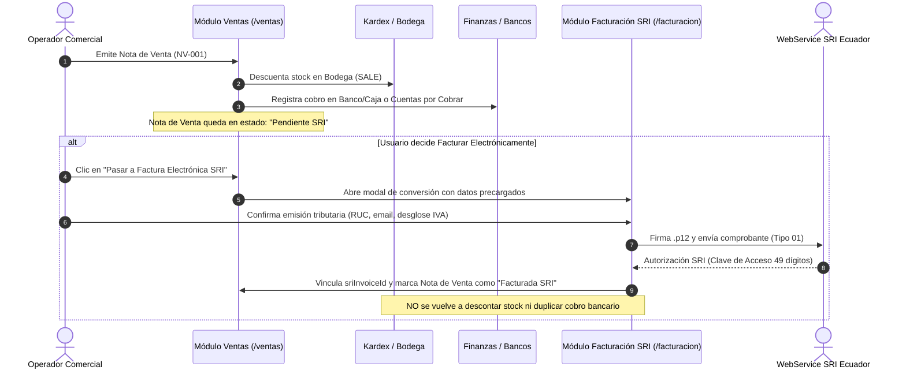

# Especificación de Diseño: Separación de Ventas Comerciales vs Facturación Electrónica SRI y Eliminación de Clientes

**Fecha:** 2026-10-24  
**Estado:** Propuesta para Aprobación  
**Módulos Afectados:** `/ventas`, `/facturacion`, `/clientes`, `Sidebar`, `state.tsx`

---

## 1. Motivación y Objetivos

### 1.1 Desacople de Ventas Comerciales y Facturación Electrónica SRI
En la operación diaria de telecomunicaciones y servicios ISP, la mayoría de transacciones comerciales corresponden a ventas de mostrador, entregas de equipos (routers, ONTs), cobros en efectivo/transferencia y recibos internos que no requieren de inmediato una factura electrónica con validación ante el SRI.
* El operador comercial necesita agilidad: emitir **Notas de Venta** operativas que descuenten inventario de bodega en tiempo real y registren ingresos en caja o banco.
* Solo cuando el administrador o el cliente lo requiera explícitamente, dicha venta comercial debe ser promovida y emitida como **Factura Electrónica SRI**.

### 1.2 Módulo de Facturación Electrónica SRI con los 5 Documentos Oficiales
El módulo de Facturación Electrónica pasa a ser un centro tributario especializado con los 5 comprobantes reglamentarios del SRI del Ecuador:
1. **Facturas Electrónicas (Tipo 01):** Generadas a partir de una Nota de Venta comercial o emitidas directamente.
2. **Notas de Crédito (Tipo 04):** Anulaciones o modificaciones de facturas autorizadas.
3. **Notas de Débito (Tipo 05):** Recargos por mora o penalidades contractuales.
4. **Comprobantes de Retención (Tipo 07):** Retenciones en la fuente e IVA a proveedores.
5. **Guías de Remisión (Tipo 06):** Traslado de equipos y mercaderías.

### 1.3 Opción Completa para Eliminar Clientes
Garantizar que el administrador pueda eliminar clientes tanto desde la tabla principal del directorio (`ClientsTable.tsx`) como desde la Ficha 360° del cliente (`ClientProfile360.tsx`), con cascada limpia de servicios, proyectos, bóveda y bitácora de auditoría.

---

## 2. Arquitectura de Navegación (Sidebar)

```
├── 📊 Dashboard              (/)
├── 👥 Clientes               (/clientes)
├── 🛒 Ventas                 (/ventas)          <- [NUEVO MÓDULO COMERCIAL]
│    ├── Notas de Venta       (/ventas?sub=notas_venta)
│    ├── Nueva Venta          (/ventas?sub=nueva_venta)
│    ├── Cotizaciones         (/ventas?sub=cotizaciones)
│    └── Recurrentes          (/ventas?sub=recurrentes)
├── 🛍️ Compras                (/compras)
│    ├── Facturas Proveedor   (/compras?sub=historial_compras)
│    └── Nueva Compra         (/compras?sub=registrar_compra)
├── 🏛️ Facturación SRI        (/facturacion)     <- [MÓDULO TRIBUTARIO 5 DOCS]
│    ├── Facturas             (/facturacion?sub=facturas)
│    ├── Notas de Crédito     (/facturacion?sub=notas_credito)
│    ├── Notas de Débito      (/facturacion?sub=notas_debito)
│    ├── Retenciones          (/facturacion?sub=retenciones)
│    ├── Guías de Remisión    (/facturacion?sub=guias_remision)
│    └── Configuración SRI    (/configuracion?sub=sri)
├── 📦 Inventarios            (/inventarios)
└── 💰 Finanzas               (/finanzas)
```

---

## 3. Flujo Comercial: De Nota de Venta a Factura Electrónica SRI



---

## 4. Detalle de Eliminación de Clientes

1. **Ubicaciones del botón Eliminar:**
   - **En `ClientsTable.tsx`:** Botón de basurero rojo en la columna de Acciones de cada fila.
   - **En `ClientProfile360.tsx`:** Botón destacado `"Eliminar Cliente"` en el encabezado principal junto al botón `"Editar"`.
2. **Modal de Confirmación Seguro:**
   - Muestra el nombre comercial, RUC y cantidad de servicios activos vinculados.
   - Si existen cuentas pendientes o registros vinculados, advierte claramente las relaciones y solicita confirmación explícita (Checkbox de confirmación o botón directo de Administrador).
3. **Limpieza en Cascada:**
   - Elimina de Firestore y memoria:
     - `clients`
     - `clientServices`
     - `clientProjects`
     - `clientQuotes`
     - `clientVaultItems`
     - `clientContracts`
     - `clientDocuments`
   - Registra en `auditLogs` la acción `"DELETE_CLIENT"` con usuario, fecha y RUC.

---

## 5. Plan de Pruebas Automatizadas

1. **Test E2E 7:** Flujo completo de emisión de Nota de Venta en `/ventas`, validación de afectación de Kardex y Banco.
2. **Test E2E 8:** Conversión de Nota de Venta a Factura Electrónica SRI evitando duplicidad de stock y movimientos bancarios.
3. **Test E2E 9:** Eliminación en cascada de Cliente y verificación de purga de servicios y bóveda.
